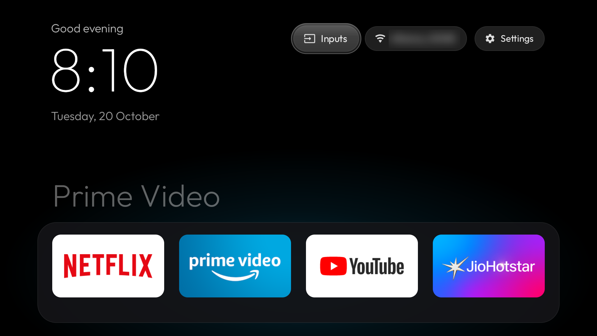

# Clean Glass for Fire TV

A clean, fast, Apple TV-style home screen for the **Fire TV Stick (Fire OS 7)**, installed from your Mac
over Wi-Fi. No root, no Amazon packages switched off by the main install, and **one command rolls
everything back**.



It builds on [Fire TV Glass](https://github.com/ivantrj/firetv-glass-launcher) by ivantrj and on
[CleanYourTV / tv-vibehack](https://github.com/Gathin23/tv-vibehack) by Gathin, and adds what it took
to make Glass feel native on Fire OS 7.

## What you get

| | |
|---|---|
| **Home in under a second** | Fire OS 7 makes background apps wait 5 seconds after every Home press. Glass now moves its own screen forward, which that hold doesn't block. Amazon's home flashes briefly, then Glass is back. |
| **A lightweight Glass** | Non-debug, pre-compiled build. One full-screen layer fewer per frame, and the glow behind the dock switches colour instantly instead of repainting half the screen on every move. |
| **Settings that work** | Fire OS 7 draws its main Settings grid inside Amazon's home, so Glass's Settings button opens a menu of the real settings pages: Network, Display & Sounds, Remotes & Bluetooth, Applications, My Fire TV, Preferences, Accessibility, Account. |
| **Arrange your apps** | Press **Menu (☰)** on any tile, then choose **Move**. Arrows move it, OK places it, Back cancels. The order is saved. |
| **Natural navigation** | Left and Right wrap across grid rows (tile 5 → 4, tile 8 → 9). |
| **Snappier everywhere** | Half-length system animations, Amazon's featured-video autoplay off, Netflix kept from running in the background. |
| **Ad-blocking** | AdGuard DNS for the whole stick, so Amazon's sponsored banners and in-app ad servers don't load. |
| **Rollback and recovery** | `uninstall` restores everything exactly. Recovery tools work from the Mac, even without the remote. |

## Before you start

- A **Fire TV Stick on Fire OS 7**. Tested on a Fire TV Stick 3rd gen (AFTSSS), Fire OS 7.7.1.6. Fire OS 8 sticks are
  covered by upstream [Fire TV Glass](https://github.com/ivantrj/firetv-glass-launcher).
- A **Mac** on the same Wi-Fi, with [Homebrew](https://brew.sh). The first setup downloads about 1 GB of build tools.
- On the stick: Settings → My Fire TV → About → select the stick's name 7 times, then **Developer options →
  ADB debugging: ON**. Note the IP address under About → Network.

## Quick start

```bash
git clone https://github.com/PAWAN-KUMAR01/clean-glass-firetv.git
cd clean-glass-firetv
bash firetv.sh setup 192.168.1.23      # your stick's IP; accept "Allow USB debugging?" on the TV
bash firetv.sh install                 # Glass + speed settings + ad-blocking (about 5 minutes)
```

Then **restart the stick once** and check that the remote and the Home button both work.

Optional extras:

```bash
bash firetv.sh tidy     # switch off Game Centre, Kids, Live Shopping, miniTV, Music, Photos; hide Luna
bash firetv.sh dock com.netflix.ninja com.amazon.firebat com.amazon.firetv.youtube in.startv.hotstar
```

When you're done, turn **ADB debugging** off again. Turn it back on whenever you want to change something.

## On the TV

| Do this | Get this |
|---|---|
| Arrows / OK | Move around and open apps. Down from the dock slides up the full grid. |
| **Menu (☰)** on a tile | **Move** (arrange) or **App info** |
| **Inputs** | Your HDMI ports by name |
| **Settings** | The settings menu above. Home from any settings page returns to Glass. |
| **Home** | Back to Glass from anywhere |

**Tip:** to switch the TV to the stick from the Fire remote, turn on HDMI-CEC on both sides. On the TV
it's often called Simplink, Anynet+ or Bravia Sync. On the stick, go to Settings → Display & Sounds → HDMI CEC Device
Control. If your TV starts on its own home screen, look for a "start on last input" option, for example Home Auto Launch → Off on LG webOS.

## Commands

| Command | What it does |
|---|---|
| `setup <ip>` | Installs the Mac tools, fetches Glass at a pinned version, connects to the stick (once) |
| `install` | Builds and installs the patched Glass and applies speed settings and ad-blocking. Saves your settings first. |
| `uninstall` | Removes Glass, gives Home back to Amazon, restores every saved setting |
| `tidy` | Optional: switches off unused Amazon apps (reversible with `uninstall`), hides Luna |
| `dock …` / `apps` | Sets the dock apps / lists package names |
| `homekey off\|on` | Home opens Amazon's screen (off) or Glass (on) |
| `adblock [off]` | Ad-blocking DNS on / off |
| `state`, `speedcheck`, `gaptest`, `gaplog`, `investigate`, `remote` | Read-only checks: screen, memory, smoothness, Home speed, health, Bluetooth |
| `key …`, `pairscreen`, `rescue`, `redirectcheck`, `resetall` | Recovery: press remote buttons from the Mac, open remote pairing, switch the redirect off, reset to stock |

## Safety, and what we learned

The main `install` changes **no Amazon packages**. It's one app, a few settings and one permission. While we built
this, an aggressive debloat and RAM cleanup left the remote unable to reconnect after a restart. It came back only after
Amazon's remote reset (unplug the stick, hold **Left + Menu + Back** for 12 seconds, take the batteries out, plug the stick back in,
put the batteries back, then hold **Home** for 10 seconds). So those steps aren't in this project, and `tidy` only switches off
apps that stayed off through restarts on the test stick with the remote working. If anything misbehaves, every recovery
command runs from the Mac, with no remote needed.

## How it works

The short version is in the table above. The details, including the measurements, the 5-second app-switch hold and why
`AppTask.moveToFront()` gets around it, the Settings problem, and the rendering changes, are in
[docs/HOW-IT-WORKS.md](docs/HOW-IT-WORKS.md).

## Credits

- [Fire TV Glass](https://github.com/ivantrj/firetv-glass-launcher) by ivantrj (MIT) is the launcher this project patches. It's
  fetched at a pinned commit during `setup`, and isn't copied here.
- [CleanYourTV / tv-vibehack](https://github.com/Gathin23/tv-vibehack) by Gathin (MIT) supplied the original idea, the approach and
  the Fire OS 7 package research.
- [AdGuard DNS](https://adguard-dns.io) provides the ad-blocking.

Not affiliated with Amazon. Fire TV is a trademark of Amazon.com, Inc. Licensed under [MIT](LICENSE).
